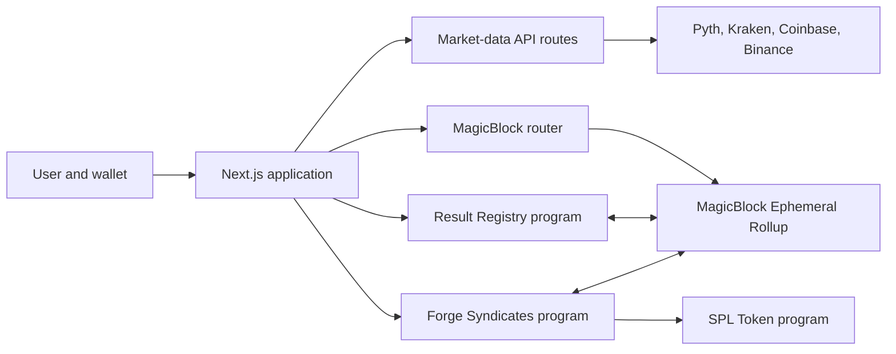
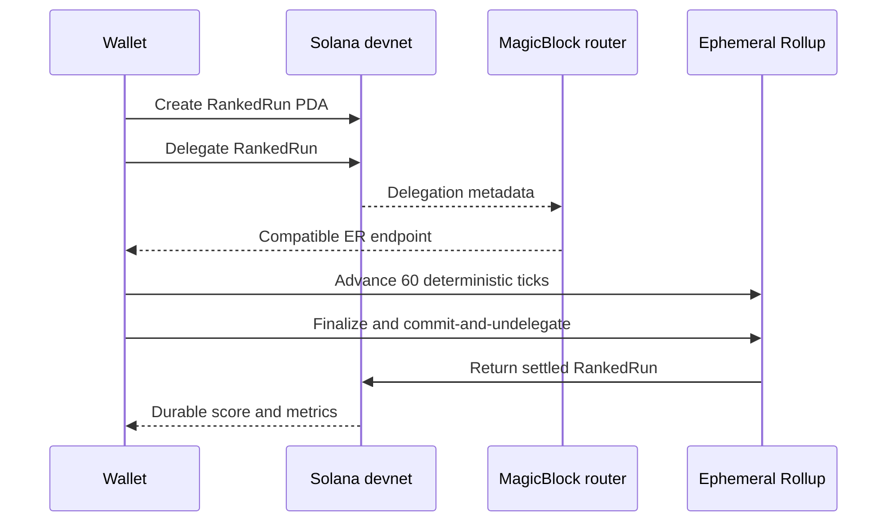
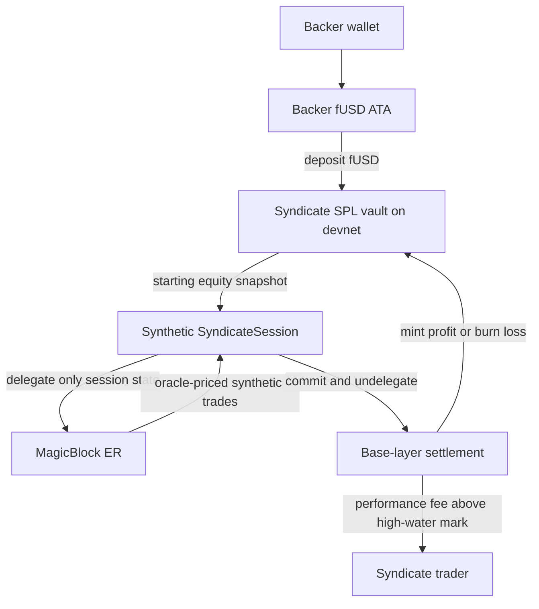

# SpreadForge Features and Architecture

SpreadForge is an educational Solana trading playground. It combines deterministic strategy challenges, oracle-priced paper trading, portfolio analytics, public rankings, and experimental social trading through MagicBlock Ephemeral Rollups.

All balances and positions are simulations. Devnet SOL is used only for transaction fees and account rent. The application does not trade or custody real assets.

## Product map

| Surface       | Purpose                                                       | Source of truth                                     |
| ------------- | ------------------------------------------------------------- | --------------------------------------------------- |
| Landing page  | Explains the product, scenarios, scoring, and execution model | Static application content                          |
| Strategy Lab  | Runs deterministic market-making challenges                   | Settled `RankedRun` account on Solana devnet        |
| Paper Trading | Practices market and limit orders against live market data    | Wallet-owned `PaperAccount` on Solana devnet        |
| Portfolio     | Explains holdings, allocation, P&L, momentum, and volatility  | `PaperAccount` plus live and historical market data |
| Syndicates    | Creates and backs social-trading pools with practice fUSD     | Forge Syndicates accounts and SPL vaults on devnet  |
| Leaderboard   | Compares verified strategy runs and paper portfolios          | Validated program accounts and Pyth prices          |

The public landing page is served at `/`. The connected trading workspace is served at `/app`.

## High-level architecture



The browser reads market data through server routes and reads durable account state directly from devnet RPC. Wallet-approved transactions create or update base-layer accounts. State that needs repeated low-latency updates is delegated to the ER selected by the MagicBlock router, then committed and undelegated back to devnet.

## Shared application features

### Wallet and network controls

- Discovers browser wallets through Wallet Standard.
- Supports devnet, testnet, mainnet, and localnet selection at the shell level.
- Restricts the current on-chain trading features to devnet.
- Keeps signing inside the connected wallet; private keys never enter application state.
- Shows transaction progress, errors, and explorer links.

### Interface and accessibility

- Responsive desktop, tablet, and mobile navigation.
- Persistent light and dark theme preference.
- Terminal-inspired visual system using DM Sans, JetBrains Mono, and Tabler icons.
- Accessible labels, dialogs, loading states, error states, and reduced-motion handling.
- Shared panels, metrics, charts, score bars, and transaction feedback components.

### Market data

The market layer supports 20 assets:

`BTC`, `ETH`, `SOL`, `XRP`, `ADA`, `DOGE`, `AVAX`, `LINK`, `DOT`, `LTC`, `BCH`, `UNI`, `AAVE`, `SUI`, `ATOM`, `NEAR`, `ETC`, `XLM`, `HBAR`, and `SHIB`.

- Live prices prefer Pyth and fall back to Coinbase and Kraken when necessary.
- Historical OHLCV data supports 1-day, 1-week, 1-month, and 1-year ranges.
- Historical providers fall back in order across Kraken, Coinbase, and Binance.
- Live order-book depth uses the same exchange fallback model.
- Responses are validated for supported markets, positive prices, freshness, and usable book structure.
- The Market Explorer provides search, filters, watchlists, quotes, and market previews.

## Feature architecture

### 1. Strategy Lab

Strategy Lab is a deterministic market-making challenge. A player configures:

- Quote spread
- Order size
- Maximum inventory
- Quote refresh interval

Available scenarios are Stable Market, Whale Sell, and Flash Crash & Recovery. Every ranked run lasts 60 ticks and starts from the same scenario-defined inventory, cash, and reference price.

The program tracks quotes, fills, inventory, realized P&L, equity, liquidity participation, and maximum drawdown. It calculates the final score on-chain; a browser-computed score cannot enter the ranked leaderboard.



The temporary session signer may advance a run only before expiry. The wallet remains the recovery authority. The leaderboard accepts only correctly owned, correctly derived, schema-compatible, fully settled `RankedRun` accounts.

### 2. Paper Trading

Paper Trading provides a wallet-owned, on-chain practice portfolio with a starting balance of 10,000 virtual USDC.

Core features:

- Twenty selectable markets
- Live price, candlestick, line, area, and depth views
- 1D, 1W, 1M, and 1Y chart ranges
- Market-order ticket with `$25`, `$50`, and `$100` presets
- Custom USD notional with derived and rounded asset quantity
- Buy, sell, and Sell Max actions
- Balance, minimum-size, and rounding validation
- Transaction preview before wallet approval
- Advanced limit quotes, local open-quote tracking, and cancellation
- Recent fills and current position information
- Read-only `Pyth live`, fallback, loading, or unavailable feed status

Every executed market trade is a wallet-authorized devnet instruction. The program checks the configured market, expected feed identity, oracle freshness, slippage, balance, and position size. It charges a 10-basis-point practice fee and stores the 16 most recent fills plus a hash chain covering the complete fill history.

Limit quotes are a client-side order-entry aid. When a quote becomes executable, its balance-changing fill still has to use the on-chain trade path.

### 3. Portfolio

Portfolio reads the same canonical `PaperAccount`; it does not duplicate the Paper Trading reducer or maintain a separate balance ledger.

It provides:

- Total portfolio value
- Total and percentage P&L
- Available virtual USDC
- Invested value
- Allocation bars
- A responsive holdings table
- Quantity, average cost, current price, value, allocation, and unrealized P&L
- One-day change, momentum, and volatility labels
- Best performer, needs-attention, and strongest-momentum spotlights
- A Trade action that opens Paper Trading on the selected asset

Current prices refresh every five seconds while the tab is active. One-day history refreshes every 60 seconds and is fetched only for owned assets. Requests are abortable and isolated, so one failed market does not hide the remaining holdings. Missing prices produce partial totals rather than substituted values.

Momentum describes one-day price movement; it is not a prediction:

| One-day change | Label                    |
| -------------- | ------------------------ |
| Above +3%      | Strong upward momentum   |
| +1% to +3%     | Upward momentum          |
| -1% to +1%     | Neutral                  |
| -3% to -1%     | Downward momentum        |
| Below -3%      | Strong downward momentum |

Volatility is the one-day high-to-low range: below 2% is low, 2–5% is moderate, and above 5% is high.

### 4. Forge Syndicates

Forge Syndicates is a separate social-trading program deployed on devnet at:

`HPNkzwiFHbWtCJLRhp7oKE1iHttjxCWvDsjtNHT9o1ZM`

It uses a worthless six-decimal classic SPL token named fUSD. Each wallet can claim 10,000 fUSD once, create a named syndicate, and back a pool. Deposits receive proportional shares, and withdrawals redeem the member's share of the vault while the syndicate is idle.

The current UI exposes discovery, faucet claim, syndicate creation, and deposits. Session execution, withdrawals, and settlement are implemented in the program and exercised by deployment scripts; their complete end-user controls are the next UI layer.

#### Custody and execution boundary



The fUSD vault never moves to the ER. Only synthetic session state is delegated. A scoped `SessionTokenV2` authorizes the temporary signer for program-approved actions; it does not grant general wallet or token authority.

Each session:

- Lasts 10 minutes
- Supports SOL and ETH synthetic positions
- Uses configured Pyth feed identities with a five-second maximum oracle age
- Allows at most 120 trades
- Limits one trade to 10% of session equity
- Limits one asset to 40% of session equity
- Stops at a 20% maximum drawdown
- Limits requested slippage to 1%

A MagicBlock scheduled task performs an idempotent expiry check and freezes the session after its deadline. Finalization persists state before commit-and-undelegate. Base-layer settlement mints practice profit or burns practice loss, applies a 10% performance fee only above the high-water mark, updates pool statistics, and writes an immutable settlement receipt.

### 5. Leaderboard

The Leaderboard has two independently verified views.

#### Strategy leaderboard

- Scans Result Registry program accounts directly.
- Validates owner, exact account size, discriminator, PDA derivation, schema, status, tick count, and timestamps.
- Supports weekly and all-time periods.
- Keeps the best eligible run per wallet.
- Ranks by score, then P&L, drawdown, completion time, and account address.
- Links every result to its devnet proof account.

#### Paper leaderboard

- Reads wallet-owned `PaperAccount` records.
- Reads the configured Pyth price accounts.
- Rejects stale, future-dated, wrongly owned, or incorrectly identified price updates.
- Values portfolios from current verified prices and marks partial market-data states explicitly.

## On-chain programs

### Result Registry

Source: `anchor/programs/vault`

Despite the folder's historical name, this program owns the active ranked-run and paper-trading state.

| Account                           | Responsibility                                                                    |
| --------------------------------- | --------------------------------------------------------------------------------- |
| `RankedRun`                       | Deterministic run configuration, tick state, fills, risk metrics, and final score |
| `PaperExchange`                   | Paper-market configuration and fee policy                                         |
| `PaperMarket`                     | Asset index, enabled state, and expected Pyth feed                                |
| `PaperAccount`                    | Wallet-owned virtual cash, positions, fills, and trade-log hash                   |
| `SessionState` and `ResultRecord` | Earlier compatibility flows retained in the program                               |

### Forge Syndicates

Source: `anchor/programs/forge-syndicates`

| Account             | Responsibility                                                        |
| ------------------- | --------------------------------------------------------------------- |
| `SyndicateConfig`   | Admin, fUSD mint, pause state, and SOL/ETH feed IDs                   |
| `FaucetReceipt`     | Enforces one fUSD faucet claim per wallet                             |
| `Syndicate`         | Trader, vault, shares, status, high-water mark, and aggregate results |
| `Membership`        | Backer shares and lifetime deposit/withdraw totals                    |
| `SyndicateSession`  | Delegated synthetic cash, positions, risk state, prices, and expiry   |
| `SettlementReceipt` | Immutable profit, loss, fee, and settlement record                    |

Both programs use deterministic PDAs and generated TypeScript clients under `app/generated`. Codama regenerates clients from the Anchor IDLs.

## Data ownership and trust boundaries

| Data                                | Authority                                    | Durable location                                |
| ----------------------------------- | -------------------------------------------- | ----------------------------------------------- |
| Theme, watchlist, open limit quotes | User/browser                                 | Browser storage or component state              |
| Market price and candles            | External providers                           | Read through server routes; not portfolio state |
| Paper balances and positions        | Result Registry program                      | Solana devnet account                           |
| Ranked score                        | Result Registry program                      | Settled `RankedRun` on devnet                   |
| fUSD and syndicate shares           | Forge Syndicates and SPL Token programs      | Solana devnet accounts and token vaults         |
| Active high-frequency session state | Owning program with scoped session authority | Router-selected MagicBlock ER                   |
| Final syndicate result              | Forge Syndicates program                     | Devnet session and settlement receipt           |

The UI treats RPC and account data as untrusted. Repository decoders verify ownership, discriminators, sizes, derivations, schemas, status, and oracle identity before using records in rankings or balances.

## Server routes

| Route                             | Responsibility                                  |
| --------------------------------- | ----------------------------------------------- |
| `GET /api/markets`                | Searchable Pyth market catalog                  |
| `GET /api/markets/:id/quote`      | Latest quote for a catalog feed                 |
| `GET /api/market/:market`         | Validated live paper-market price with fallback |
| `GET /api/market/:market/history` | OHLCV history for chart ranges or replay        |
| `GET /api/market/:market/book`    | Validated live order-book depth                 |

Provider credentials remain server-side. Browser code never receives the optional Hermes API key or script keypair paths.

## Deployment and feature gates

| Variable                                  | Effect                                               |
| ----------------------------------------- | ---------------------------------------------------- |
| `NEXT_PUBLIC_RESULT_REGISTRY_PROGRAM_ID`  | Enables Result Registry account derivation and reads |
| `NEXT_PUBLIC_MAGICBLOCK_ENABLED`          | Enables MagicBlock client flows                      |
| `NEXT_PUBLIC_RANKED_RUNS_ENABLED`         | Enables ranked Strategy Lab runs                     |
| `NEXT_PUBLIC_FORGE_SYNDICATES_PROGRAM_ID` | Enables Syndicates discovery and wallet actions      |
| `NEXT_PUBLIC_MAGICBLOCK_BASE_RPC_URL`     | Configures MagicBlock's base-layer RPC               |
| `NEXT_PUBLIC_MAGICBLOCK_ROUTER_URL`       | Configures account-specific ER discovery             |

The Forge Syndicates program has been deployed, initialized, and verified through a full devnet smoke test. Production or mainnet operation is not enabled; the product remains an educational devnet system.

## Development and verification

```bash
npm install
npm run dev

npm run test
npx tsc --noEmit
npm run lint
npm run build
npm run test:e2e

npm run anchor-test
npm run codama:js
```

Operational scripts:

- `scripts/configure-paper-markets.mjs` registers paper markets and feed IDs.
- `scripts/pyth-price-pusher.mjs` maintains deterministic devnet price-update accounts.
- `scripts/initialize-syndicates.mjs` initializes Forge Syndicates and the fUSD mint.
- `scripts/smoke-syndicates.mjs` verifies the complete SessionToken, ER, crank, trade, commit, and settlement lifecycle.
- `scripts/recover-syndicates-smoke.mjs` safely recovers and settles an expired delegated smoke session.

## Repository guide

```text
app/
├── app/                         Connected workspace at /app
├── api/                         Server-side market-data adapters
├── components/                  Landing and workspace interfaces
├── generated/                   Codama-generated program clients
└── lib/                         Wallet, market, simulation, ranking, and ER logic

anchor/
├── programs/vault/              Result Registry: ranked runs and paper portfolios
└── programs/forge-syndicates/   fUSD pools and delegated social-trading sessions

scripts/                         Devnet setup, oracle, deployment, and smoke tooling
docs/                            Product, architecture, scoring, and release documentation
e2e/                             Responsive workspace and chart browser tests
```

## Current product boundary

SpreadForge proves that trading practice can remain fast and interactive while final results stay publicly verifiable. It is not a brokerage, investment adviser, prediction service, yield product, or mainnet fund manager. Momentum labels describe past movement only, and fUSD has no monetary value.
