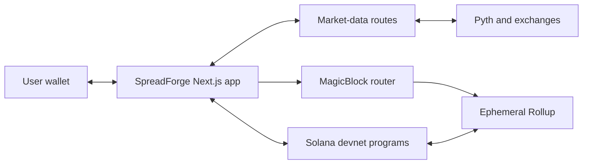

# Simple Architecture

## Architecture in one sentence

Next.js provides the interface, Solana devnet stores durable state, Pyth and exchange APIs provide market context, and MagicBlock executes repeated low-latency session updates.

## Frontend

- Next.js and React
- Wallet Standard connection
- Solana Kit transaction clients
- Codama-generated typed program clients
- Lightweight Charts for trading visuals
- Responsive terminal-style component system

## Market-data layer

Server routes normalize external responses before they reach the browser.

- Pyth: preferred live prices and on-chain oracle verification
- Kraken: live fallback, history, and order book
- Coinbase: live fallback, history, and order book
- Binance: historical and order-book fallback

## Result Registry program

The Result Registry owns:

- Ranked strategy runs
- Paper exchange configuration
- Paper market feed configuration
- Wallet-owned paper portfolios
- Legacy result accounts kept for compatibility

## Forge Syndicates program

The separate Syndicates program owns:

- Protocol configuration
- fUSD mint authority
- Faucet receipts
- Syndicate pools
- Backer memberships and shares
- Delegated synthetic sessions
- Settlement receipts

## Base layer versus Ephemeral Rollup

| Solana devnet               | MagicBlock ER                        |
| --------------------------- | ------------------------------------ |
| Durable ownership           | Fast repeated updates                |
| Wallet-created accounts     | Temporary delegated execution        |
| SPL token vaults            | Synthetic positions only             |
| Final scores and settlement | Active strategy or syndicate session |
| Recovery boundary           | Router-selected execution endpoint   |

## The most important security boundary

Delegation changes where an account executes; it does not remove program authorization rules. Session keys remain scoped, oracle feeds are verified, and final state must return to the owning program on devnet.

## What to say

> The architecture separates speed from finality. Fast session updates happen on MagicBlock, while ownership, token custody, scores, and settlement remain durable on Solana devnet.
